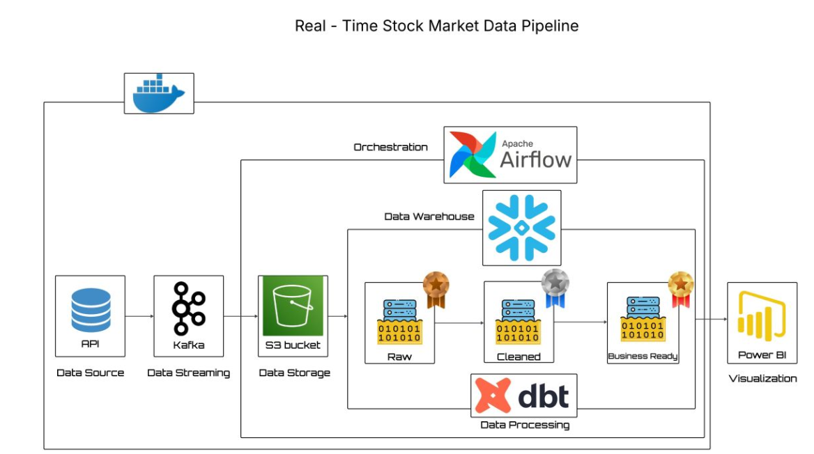
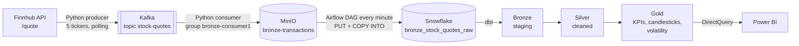

# Real-Time Stock Market Data Pipeline

End-to-end ELT pipeline on **live market data** (not simulated): stock quotes are fetched from the
Finnhub API, streamed through **Kafka**, landed in a **MinIO** data lake, loaded into **Snowflake**
every minute by **Airflow**, modeled with **dbt** in Bronze / Silver / Gold layers and visualized in
**Power BI** (DirectQuery).



## Pipeline



| Step | Component | What it does |
|---|---|---|
| Extract | `producer/producer.py` | Polls the Finnhub `/quote` endpoint for AAPL, MSFT, TSLA, GOOGL and AMZN, adds `symbol` and `fetched_at`, publishes JSON to the `stock-quotes` topic (5 retries, 1 s backoff, API key read from `.env`). |
| Stream | Kafka + Zookeeper, Kafdrop | Decouples the API rate from storage and allows replay through consumer offsets. |
| Land | `consumer/consumer.py` | Consumes the topic and writes each quote to MinIO as `{symbol}/{timestamp}.json` (bucket created if missing). |
| Load | `infra/dags/minio_to_snowflake.py` | Airflow DAG, every minute: downloads the new files from MinIO, then bulk-loads them into Snowflake with an internal stage (`PUT` + `COPY INTO`). |
| Transform | `dbt_stocks/` | 5 dbt models: JSON parsing and typing (Bronze), cleaning and rounding (Silver), 3 analytical models (Gold). |
| Visualize | Power BI | Candlestick chart, volatility treemap and a sortable real-time KPI table on the Gold layer. |

## dbt models

| Layer | Model | Content |
|---|---|---|
| Bronze | `bronze_stg_stock_quotes` | Extracts and types the fields of the raw JSON (`VARIANT`) |
| Silver | `silver_clean_stock_quotes` | Rounded prices, rows without a price removed |
| Gold | `gold_kpi` | Latest quote per symbol (`ROW_NUMBER`): price, change, change % |
| Gold | `gold_candlestick` | Daily OHLC candles and a trend line per symbol (window functions) |
| Gold | `gold_treechart` | Average price, volatility (`STDDEV_POP`) and relative volatility (coefficient of variation) |

## Engineering fixes

Two silent bugs found while running the pipeline:

1. **Silent data loss after 1,000 files.** `list_objects_v2` returns at most 1,000 objects per call.
   Once the bucket grew past that size, new quotes stayed in MinIO but never reached Snowflake.
   The DAG now walks every page with a boto3 **paginator**.
2. **File name collisions.** Downloading `AAPL/1700000000.json` and `TSLA/1700000000.json` with
   `os.path.basename` produced the same local file name, so one quote overwrote the other. Local
   names now keep the symbol (`AAPL_1700000000.json`), and the temporary folder is emptied at the
   start of each run so a run never reloads the files of the previous one.

## Run it

Requirements: Docker, Python 3.10+, a Finnhub API key and a Snowflake account.

```bash
pip install -r requirements.txt
cp .env.example .env            # FINNHUB_API_KEY for the producer
cp .env.example infra/.env      # SNOWFLAKE_* for the Airflow DAG

cd infra
docker compose up -d            # Zookeeper, Kafka, Kafdrop, MinIO, Airflow, Postgres

# First start only: initialize the Airflow metadata database and create an admin user
docker compose run --rm airflow-webserver airflow db migrate
docker compose exec airflow-webserver airflow users create --role Admin \
  --username admin --firstname <first> --lastname <last> --email <email> --password <password>
cd ..

python producer/producer.py     # terminal 1
python consumer/consumer.py     # terminal 2
```

Then enable the `minio_to_snowflake` DAG in Airflow (http://localhost:8080) and run the dbt models
against Snowflake (`dbt run`).

| Interface | URL |
|---|---|
| Airflow | http://localhost:8080 |
| Kafdrop (Kafka UI) | http://localhost:9000 |
| MinIO console | http://localhost:9001 |

## Limitations and next steps

- dbt runs separately from the DAG: the next step is a `dbt run` + `dbt test` task after `load_snowflake`.
- One JSON file per message creates many small files: batching in the consumer, or Snowpipe /
  the Snowflake Kafka connector, would scale better.
- The DAG lists the whole bucket on each run; date prefixes or a `processed/` folder would avoid it.
- Outside market hours the API returns the last quote again: deduplicating on
  `(symbol, market_timestamp)` would remove these repeats.
- Development setup: single Kafka broker, replication factor 1, local credentials.

## Repository structure

```text
producer/                Kafka producer (Finnhub API)
consumer/                Kafka consumer (MinIO sink)
infra/
  docker-compose.yml     Zookeeper, Kafka, Kafdrop, MinIO, Airflow, Postgres
  dags/                  Airflow DAG: MinIO -> Snowflake
dbt_stocks/dbt_stocks/models/
  bronze/                staging model and source declaration
  silver/                cleaned quotes
  gold/                  KPIs, candlesticks, volatility
images/                  architecture diagram
```
